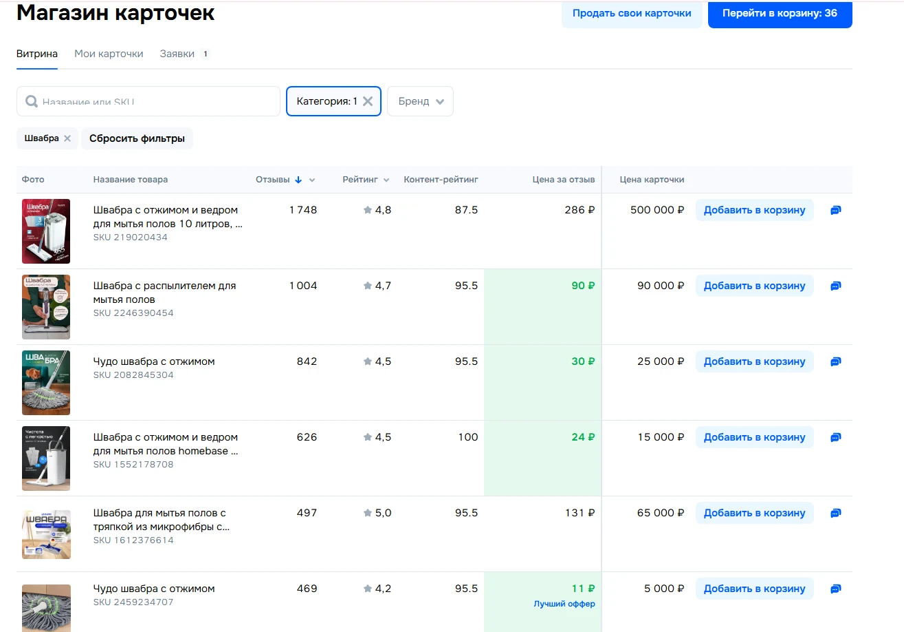

# Ozon SKU Shop Best Offers

Расширение для **Яндекс Браузера и Google Chrome**: добавляет на страницу «Магазин карточек» в Ozon Seller столбец **«Цена за отзыв»** сразу после столбца «Контент-рейтинг». Позволяет быстро увидеть самые выгодные предложения по цене одного существующего отзыва.



## Установка в Яндекс Браузере

1. Скачайте архив с файлами проекта (кнопка **Code → Download ZIP** на GitHub или [архив проекта](https://github.com/nullalterbrain/Ozon-sku-shop-best-offers/archive/refs/heads/main.zip)). Распакуйте его в постоянную папку.
2. В адресной строке **Яндекс Браузера** введите **`browser://extensions`** и нажмите Enter.
3. Включите **«Режим разработчика»** на странице расширений.
4. Нажмите **«Загрузить распакованное расширение»** и выберите папку, в которой лежит `manifest.json` (это корень проекта).
5. Откройте `https://seller.ozon.ru/app/items/store?activeTab=allListings` и обновите страницу.

## Установка в Google Chrome

1. Скачайте ZIP из репозитория и распакуйте в постоянную папку.
2. В адресной строке **Google Chrome** введите **`chrome://extensions`** и нажмите Enter.
3. В правом верхнем углу включите **«Режим разработчика» (Developer mode)**.
4. Нажмите **«Загрузить распакованное расширение» (Load unpacked)** и выберите папку проекта с `manifest.json`.
5. Откройте «Магазин карточек» Ozon Seller и обновите страницу.

**Важно:** выбирайте именно распакованную папку, не ZIP-файл. Не удаляйте папку после установки. После обновления файлов проекта нажмите «Обновить» у расширения на странице расширений.

## Как работает

- **Цена за отзыв** = «Цена карточки» / количество отзывов. Результат отображается в рублях с точностью до двух знаков после запятой.
- Если цена одного отзыва **строго меньше 100 ₽**, ячейка подсвечивается зелёным.
- **«Лучший оффер»** получает карточка с минимальной ценой за отзыв среди загруженных строк **текущей страницы, не добавленных в корзину**.
- При нажатии штатной кнопки Ozon «Добавить в корзину» и её смене на «Убрать из корзины» отметка автоматически переходит к следующему подходящему предложению. При удалении карточки из корзины она снова участвует в сравнении.
- Если цены равны, лучшим считается первый товар в порядке отображения таблицы.
- Если отзывов нет или число отзывов равно нулю, выводится «—». Пустые строки загрузки Ozon пропускаются.
- Фильтрация, сортировка, подгрузка и замена строк обрабатываются без ручного запуска скрипта.

Расширение **не добавляет товары в корзину само** и **не выполняет сетевых запросов**. Используется только информация, уже отображённая на странице Ozon. Доступ к Ozon API, аккаунт и API-ключ в расширение вводить не нужно.

## Состав проекта

| Файл | Назначение |
| --- | --- |
| `manifest.json` | Конфигурация расширения Manifest V3 |
| `content.js` | Расчёты и наблюдение за изменениями таблицы |
| `style.css` | Оформление нового столбца |
| `icons/` | Иконки расширения |
| `assets/screenshot.webp` | Скриншот работы на странице Ozon |
| `tests/test_extension.py` | Автоматизированные проверки DOM (Playwright) |
| `AGENTS.md` | Контекст и правила для AI-ассистентов и разработчиков |

## Тестирование

Нужны Python 3, пакет `playwright` и браузер Chromium:

```bash
pip install playwright
python -m playwright install chromium
python -m unittest discover -s tests -p 'test_extension.py' -v
```

Тесты работают на **синтетической HTML-таблице** и проверяют расчет, пустые строки, переключение корзины, изменения цены, перерисовку DOM и варианты заголовка. Тесты на сохранённой HTML-копии также проводились локально, однако она не включена в публичный репозиторий.

## Ограничения

- Данные анализируются только из строк, загруженных на **текущей странице** таблицы. Другие страницы не обходятся.
- Статус корзины определяется по доступному в интерфейсе тексту «Убрать из корзины»/«В корзине»; если Ozon изменит формулировки или разметку, потребуется обновление расширения.
- Если интерфейс Ozon существенно изменится, нужно скорректировать логику поиска таблицы и колонок в `content.js`.
- Точность отображения — две цифры после запятой; для выбора победителя используются **неокруглённые** значения.

## Лицензия

MIT — см. [LICENSE](LICENSE).